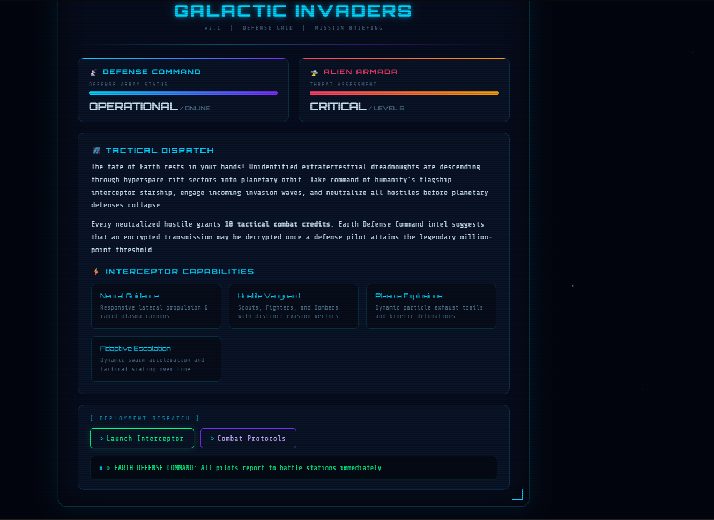
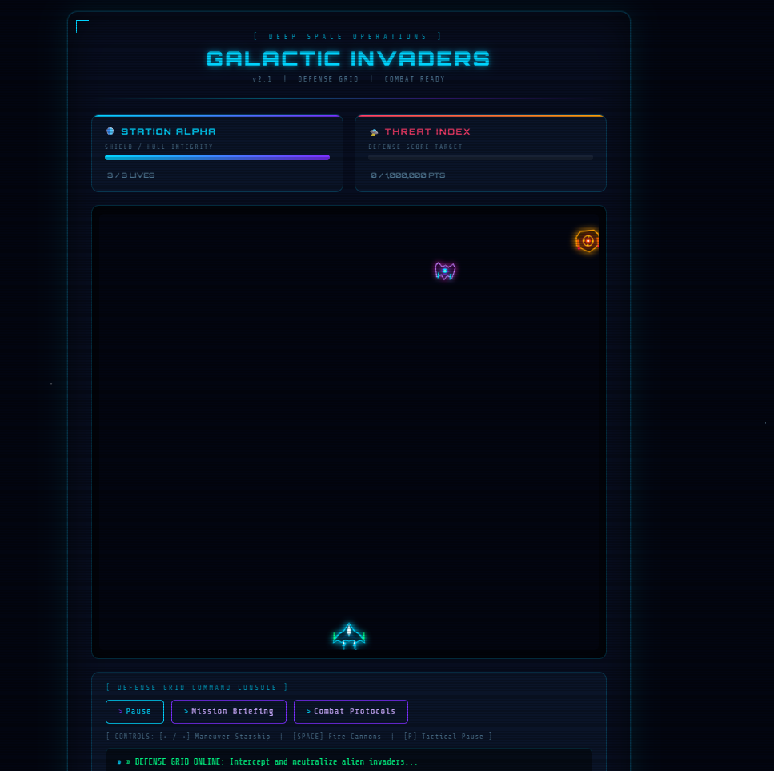
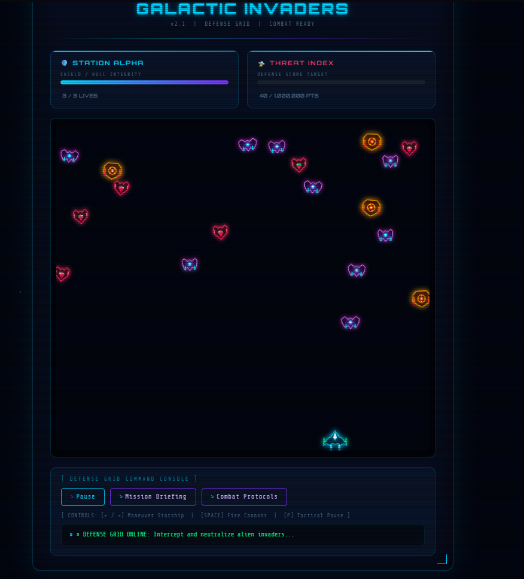
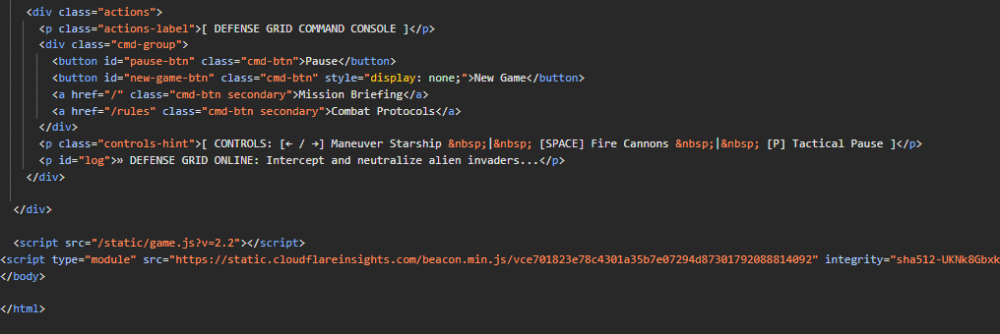
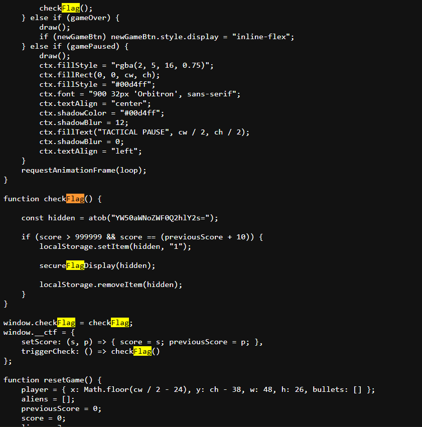
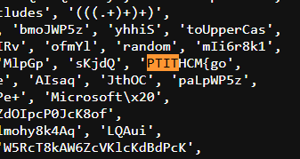
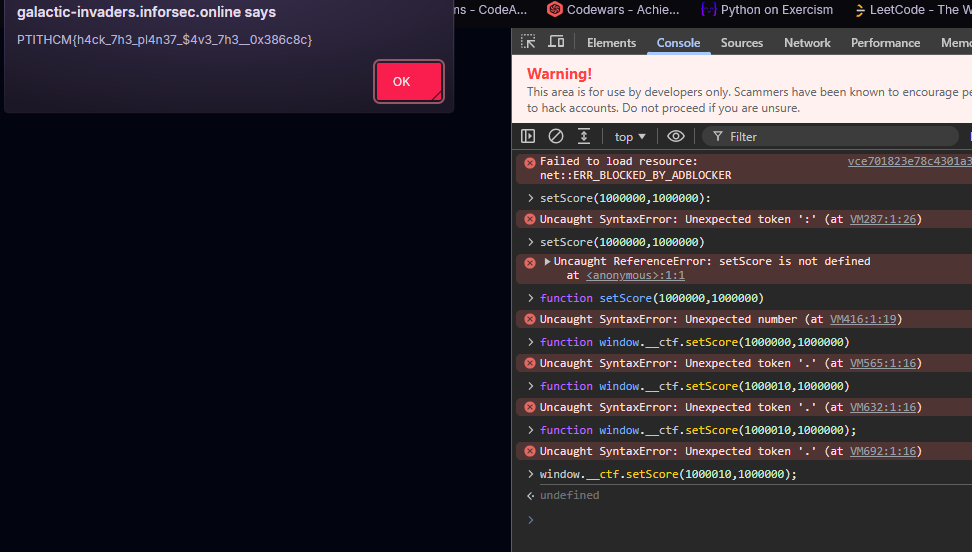

# Galactic Invaders



The first thing I did was explore the website’s main page and test all the buttons. I clicked on “Launch Interceptor,” which opened a game.



I noticed was the Threat Index, which showed 0/1,000,000. I tried playing the game and firing a few projectiles.



The score increased only slightly, so I checked the source code.



/static/game.js?v=2.2 caught my eye, so I opened it in another tab. While searching for “flag” in the source, I found an exploitable function.



```text
function checkFlag() {

        const hidden = atob("YW50aWNoZWF0Q2hlY2s=");

        if (score > 999999 && score == (previousScore + 10)) {
            localStorage.setItem(hidden, "1");

            secureFlagDisplay(hidden);

            localStorage.removeItem(hidden);
        }
    }

    window.checkFlag = checkFlag;
    window.__ctf = {
        setScore: (s, p) => { score = s; previousScore = p; },
        triggerCheck: () => checkFlag()
    };
```

I also found a Base64-encoded string, so I decoded it. It turned out to be anticheatCheck, which is used as a localStorage key. Once the score conditions are satisfied, the code temporarily sets this key to "1". I noticed two inputs here: score and previousScore. The score must be greater than 999999, and previousScore must be exactly 10 points lower than score.



After looking up how to call a function in the console, I entered `window.__ctf.setScore(1000010, 1000000);` in console

The flag finally appeared.



```text
PTITHCM{h4ck_7h3_pl4n37_$4v3_7h3__0x386c8c}
```

## Conclusion

The game exposes a function that allows the score variables to be modified from the browser console. This allowed me to obtain the flag without finishing the game.
